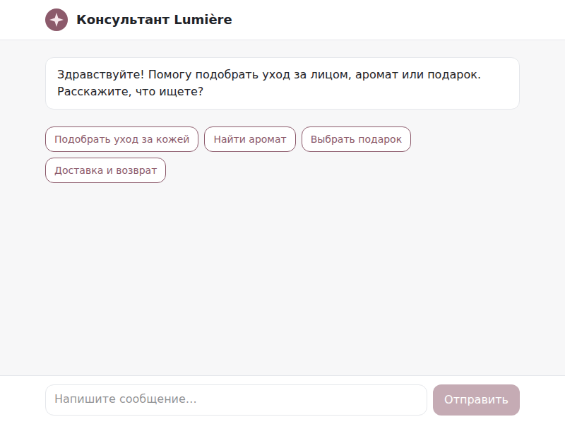
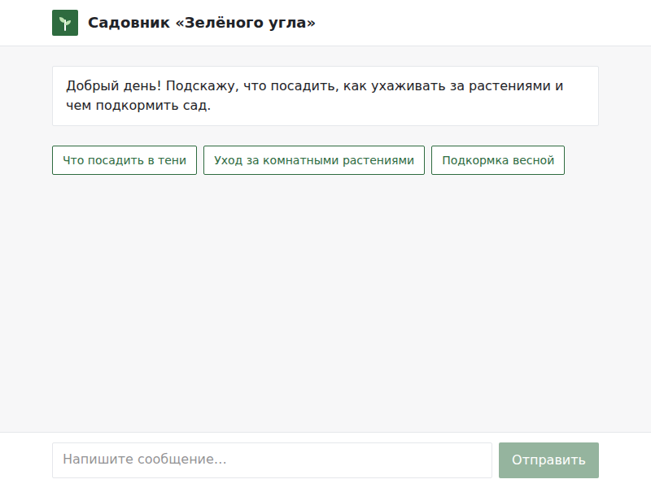
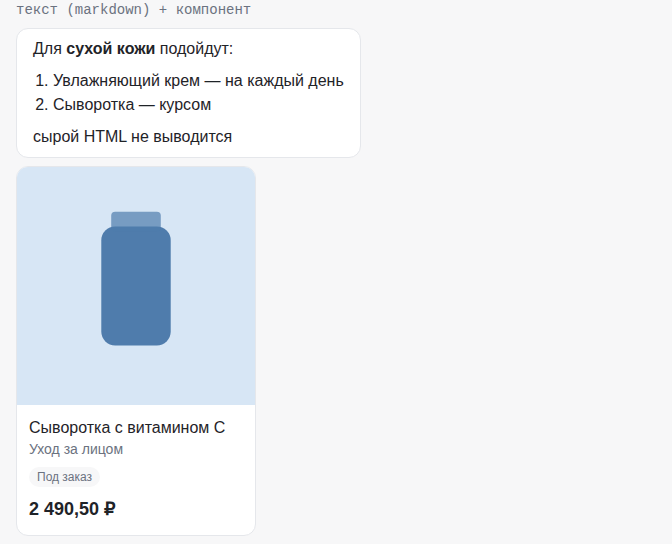
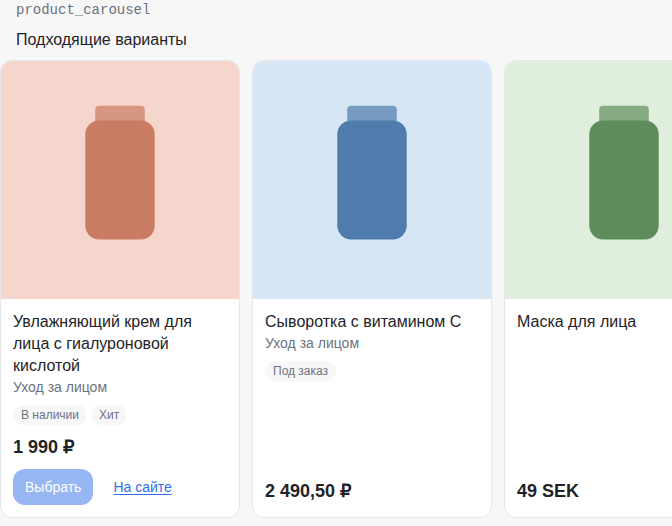
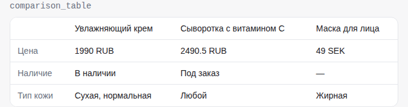
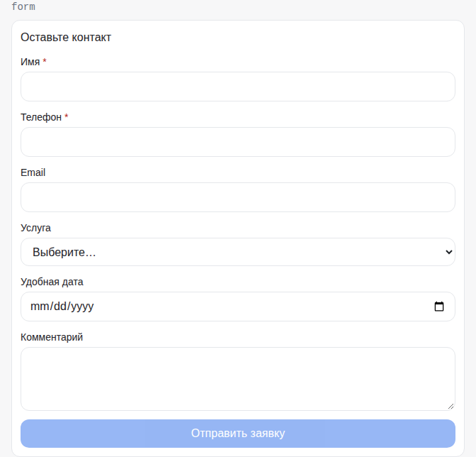
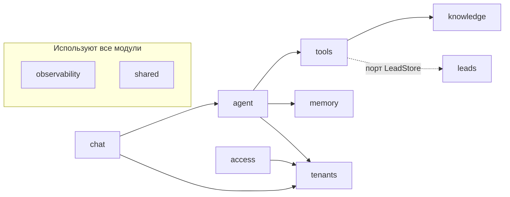

# Tessera

Платформа AI-консультантов для бизнеса: агент получает знания компании и ведёт клиента
от вопроса до решения прямо в чате — уточняет, подбирает товары из каталога, показывает
карточки и принимает заявки.

## Демо

Две демо-витрины на одном ядре — отличаются только конфигурацией тенанта (сценарии,
каталог, база знаний, формы, брендинг):

- **[Lumière](https://tessera-agent.ru/demo/shop/lumiere.html?key=wk_2l0yAE2v442gGvaZYWlczubnJ9N9oLtdcD33YA9AEbU)** —
  косметика и парфюмерия (`apps/web/public/demo/shop/lumiere.html`)
- **[Зелёный угол](https://tessera-agent.ru/demo/shop/garden.html?key=wk_GX3mmg20q1tNvJqOhxwBT-zTzcyIBF70iUO9zGuvc1A)** —
  садовый центр (`apps/web/public/demo/shop/garden.html`)

Демо работает на tessera-agent.ru. Ассистент — кнопка в правом нижнем углу витрины,
примеры вопросов — в баннере.

Локально (после [быстрого старта](#быстрый-старт)):
`http://localhost:3000/demo/shop/lumiere.html?key=<ключ виджета>` и `.../garden.html?key=…`.
Сценарии показа — [docs/demo.md](docs/demo.md).

**Один чат — два тенанта.** Стартовый экран Lumière и «Зелёного угла»: название, иконка,
цвета, приветствие и быстрые ответы берутся из конфигурации тенанта, код чата один.

<table>
  <tr>
    <td></td>
    <td></td>
  </tr>
</table>

**UI-компоненты чата.** Ответ модели (markdown) и компоненты, которые присылают инструменты
бэкенда: карусель товаров, таблица сравнения, форма заявки. Снимки сделаны на тестовых
данных витрины компонентов (`/demo/components`, только в dev-режиме) — те же, что
проверяют snapshot-тесты Playwright.

<table>
  <tr>
    <td></td>
    <td></td>
  </tr>
  <tr>
    <td></td>
    <td></td>
  </tr>
</table>

<!-- TODO: скриншот или GIF живого диалога: «Сухая кожа, шелушится зимой — что посоветуете?»
     → уточняющие вопросы → карусель кремов из каталога, ответ стримится -->

## Возможности

- **Агентный цикл с инструментами.** Модель сама решает, искать ли в знаниях, в каталоге,
  уточнить или показать карточки; состояние диалога (слоты сценария, показанные товары)
  переживает ходы.
- **Знания из источников компании.** Сайт (sitemap, robots.txt), файлы (PDF, DOCX, Markdown, TXT, XLSX, CSV),
  HTTP API и внешние БД; гибридный поиск в Qdrant (векторы + BM25) с опциональным реранкингом.
- **Структурный поиск по каталогу.** Фильтры по атрибутам, цене и наличию плюс полнотекстовый
  поиск Postgres — цены и наличие не берутся из текста модели.
- **Интерактивный чат.** Карточки и карусели товаров, таблица сравнения, формы заявки,
  подтверждение действий, быстрые ответы; встраивается на сайт одной строкой (`widget.js`).
- **Мультитенантность и админка.** Тенант — это конфигурация и данные; в админке —
  версии конфига агента, источники, диалоги с разбором хода по шагам, заявки с выгрузкой в CSV.
- **Надёжность и наблюдаемость.** Журнал событий агента, трейсы в Langfuse с маскированием
  персональных данных, ретраи и fallback провайдера LLM, бюджет токенов хода, лимиты частоты.
- *В работе:* продолжение ответа после перезагрузки страницы (P7-06b).

## Архитектура

Модульный монолит: каждый модуль — `domain / application / infrastructure / api`, другие
модули видят только его `public.py` (проверяет import-linter).



Ключевые решения:

- Модульный монолит с границами через `public.py` — [ADR-0001](docs/adr/0001-modular-monolith.md).
- Агент — цикл с инструментами, а не конвейер «поиск → ответ» — [ADR-0002](docs/adr/0002-agent-loop-with-tools.md).
- Каталог ищется структурно (фильтры, SQL, FTS), векторы — только для текстов — [ADR-0003](docs/adr/0003-structured-catalog.md), [ADR-0016](docs/adr/0016-catalog-query-postgres-fts.md).
- UI-компоненты в чат отправляют инструменты из данных БД, а не модель текстом — [ADR-0004](docs/adr/0004-ui-components-via-tools.md).

Подробнее: [docs/architecture.md](docs/architecture.md), контракты SSE и компонентов —
[docs/contracts.md](docs/contracts.md), все решения — [docs/adr/](docs/adr/).

## Стек

- **Backend:** Python 3.12, FastAPI, SQLAlchemy 2 (async, asyncpg), Alembic, Pydantic,
  structlog, arq (фоновые задачи на Redis).
- **Данные:** PostgreSQL 16, Redis, Qdrant.
- **LLM:** OpenAI SDK (Responses API и совместимые Chat Completions), Anthropic SDK; трейсы — Langfuse.
- **Frontend:** Next.js 16 (App Router), React 19, TypeScript, Tailwind CSS 4, react-markdown.
- **Тесты и качество:** pytest, Playwright, ruff, mypy (strict), import-linter, ESLint.
- **Инфраструктура:** uv, pnpm, Docker Compose, Caddy (боевой стек).

## Статус

- Готово: этапы P0–P8 roadmap — каркас, агент, эвалы, знания, rich UI, качество диалога,
  надёжность, мультитенантность и админка; демо-витрины, ревью кода и безопасности
  перед выкладкой.
- Выложено (P9-01b, октябрь 2026): один VPS, Docker Compose за Caddy с HTTPS, раздельные
  роли Postgres, хранилища без доступа снаружи, ежедневный бэкап — [docs/deploy.md](docs/deploy.md).
- В работе: пилот с реальными диалогами (P9-02), продолжение стрима после перезагрузки (P7-06b).
- Качество диалога проверяется на 34 эталонных диалогах двух тенантов (`evals/`), порог —
  ≥ 92% проверок.

Пилот — консультант магазина косметики и парфюмерии: [docs/pilot.md](docs/pilot.md).
Задачи по этапам: [docs/roadmap.md](docs/roadmap.md).

## Быстрый старт

Нужны `git`, `make`, Docker, [uv](https://docs.astral.sh/uv/), Node.js 24 и pnpm
(`corepack enable`).

```bash
git clone https://github.com/julipel/Tessera.git
cd Tessera
cp .env.example .env   # ключ провайдера LLM (OPENAI_API_KEY и др.), SEED_WIDGET_KEY
make install           # зависимости по lock-файлам
make up                # Postgres, Redis, Qdrant в Docker
make pilot             # миграции + демо-тенанты + индексация источников (migrate, seed, sync)
```

Запуск — в трёх терминалах:

```bash
make dev-api           # API на :8000
make worker            # фоновые задачи (синхронизация источников, чистка по срокам хранения)
make dev-web           # web на :3000
```

Чат: `http://localhost:3000/?key=<ключ виджета>`, витрины — `http://localhost:3000/demo/shop/`.
Ключи виджета задаёт `SEED_WIDGET_KEY` (иначе `make seed` сгенерирует и напечатает их).

## Как сделано

Проект разрабатывается с Claude Code по одной задаче roadmap за сессию:

- [CLAUDE.md](CLAUDE.md) — жёсткие правила (границы модулей, изоляция тенантов, без бизнес-логики в ядре).
- Контракты — JSON Schema в [packages/contracts/schemas/](packages/contracts/schemas/), из них `make contracts` генерирует Pydantic и TypeScript.
- Сабагенты в [.claude/agents/](.claude/agents/): reviewer, test-writer, frontend, prompt-engineer.
- Хуки качества в [.claude/hooks/](.claude/hooks/): защита сгенерированных файлов и `.env`, автоформат, `make check-fast` в конце сессии.
- Эталонные диалоги в [evals/](evals/) с LLM-судьёй (`make eval`): промпты меняются только через эвалы; архитектурные решения — через ADR.

Процесс и команды разработки — [docs/development.md](docs/development.md), выкладка на сервер —
[docs/deploy.md](docs/deploy.md).

## Структура репозитория

```
apps/api/                    backend: FastAPI, модули app/modules/*, миграции, evals-раннер
apps/web/                    frontend: чат, виджет, админка, демо-витрины
packages/contracts/schemas/  JSON Schema контрактов
config/tenants/              конфигурация демо-тенантов
evals/                       эталонные диалоги и отчёты
deploy/                      боевой стек: compose, Caddy, роли Postgres
scripts/                     генерация контрактов, публичное демо, нагрузочный тест
docs/                        архитектура, контракты, roadmap, пилот, выкладка, ADR
.claude/                     правила, хуки, команды и сабагенты Claude Code
```
